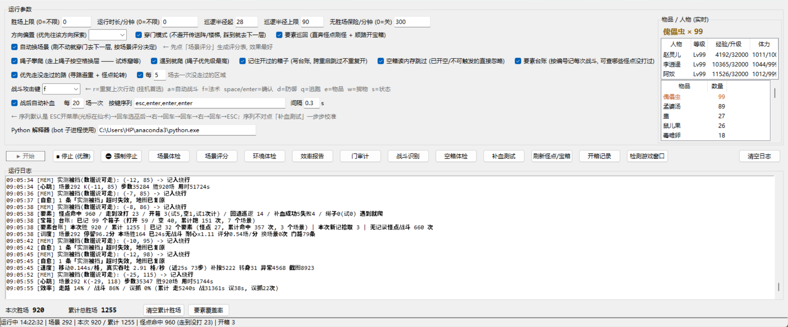
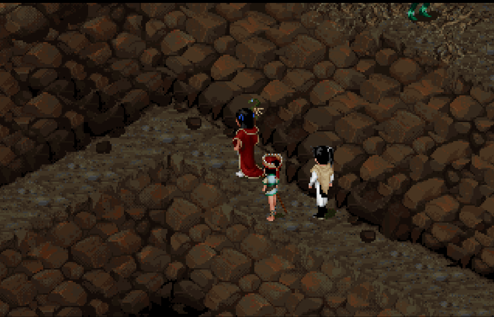
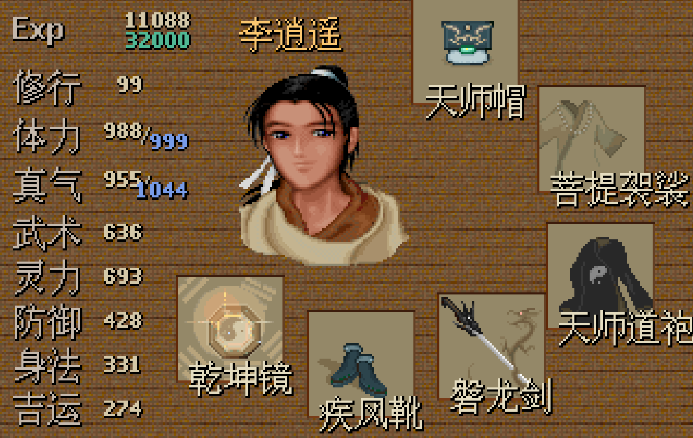
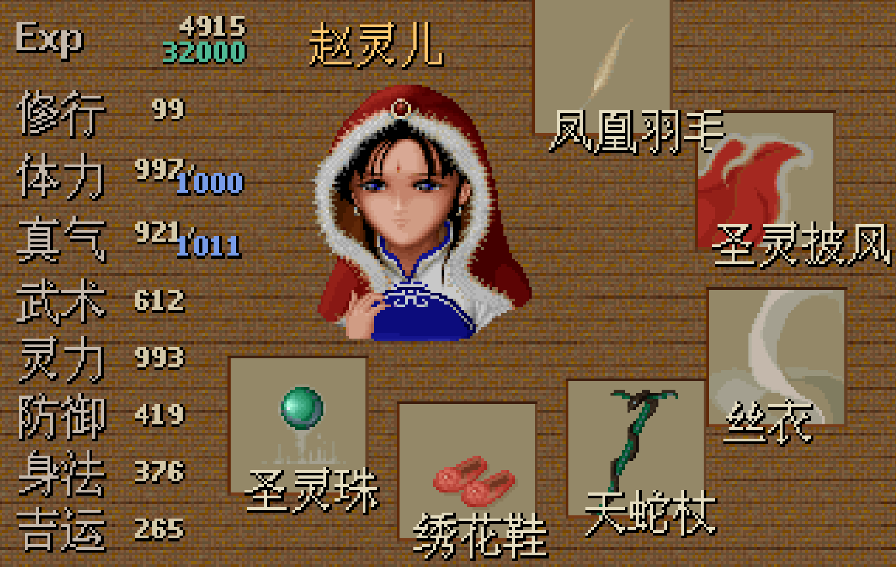
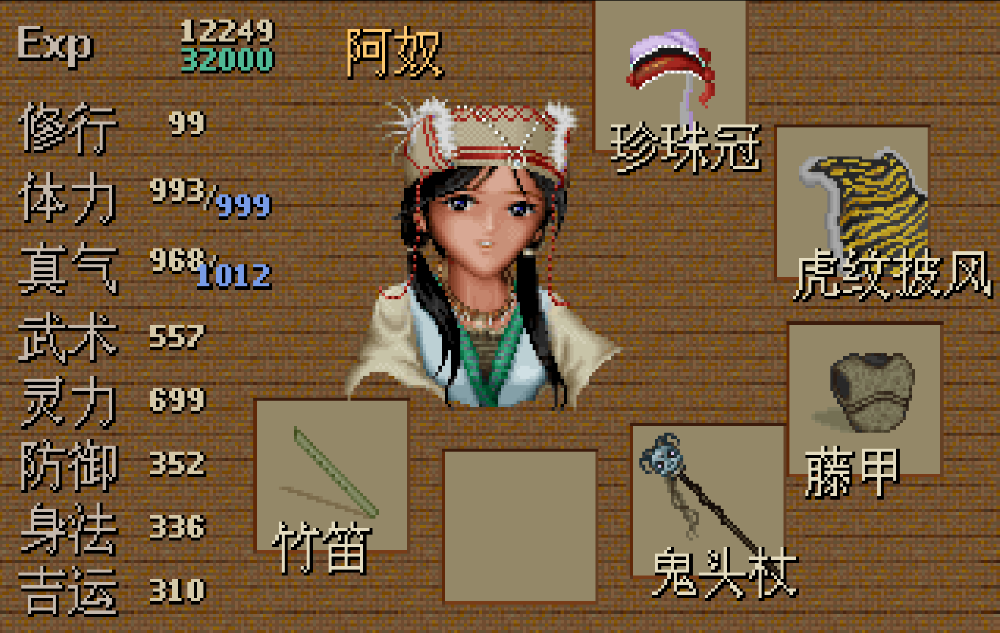

# 仙剑98 挂机机器人 (PAL98 Auto-Battle Bot)


（程序图标 —— 仙剑 + 右下角循环箭头「挂机」，运行时显示在任务栏/标题栏；
图标生成器见 `tools/make_icon.py`）

## 作者的话

  灵感来源于传说中的“十里坡剑神”，今年三、四月份的时候，突然想玩儿之前玩儿的一些老游戏，就选择了仙剑，以前买的正版盘找不到了，就开始尝试某在线平台，效果确实差强人意，后来发现了 SDLPAL，感觉跟原版挺像的（并没有实际对比过）。

  当时 openclaw 比较火，通关后就想能不能让AI来自己玩儿这个游戏，经过长时间的测试，发现——不行，就放弃了，最近 workbuddy 火了，就用它试了试开发一个仙一练级的机器人，也是经过了重重波折，大概消耗了4000积分，达到了现在这个程度。

  目前机器人可以在某一场景中自动练级，实测在试炼窟把李逍遥、赵灵儿、阿奴均练到了99级；后面会找个时间在十里坡挂一个，看看AI能不能挂出一个十里坡剑神出来。

  说实话，就是图个乐，实际想用它练级效率不高，到期还有点笨，但比坐在电脑前自己刷还是省劲太多了，如果你怕后面关卡打起来费劲，可以找个地图让机器人帮你挂一夜，后续任务会比较轻松，有兴趣的可以尝试一下。

## 以下部分为AI生成


基于**内存真值引擎**的《仙剑98柔情版》(SDLPAL) 自动刷怪机器人，带图形界面。
不是靠截图猜位置，而是直接读取游戏内存中的场景号、坐标、地图数据来导航——
因此**不迷路、不跑丢、误判率极低**。实测长跑 17.5 小时 **1281 胜（1.22 场/分）**。



*机器人主界面：上半是运行参数与即时物晶/人物状态，中部一键功能区，下部实时日志；
最底下一行就是 v19.0 拆分的「**本次胜场 920 / 累计总胜场 1255**」与要素台账统计。*



*游戏实况：机器人正带着队伍在洞窟场景里直奔下一个怪点。*

> 📌 **当前是公开测试版（beta）**。核心功能已实测长跑稳定，但内存地址是按
> **某一个具体的 SDLPAL 构建**标定的 —— 换 exe / 换版本可能失效，所以**跑之前先做一次
> 「环境体检」**（约 5 秒，对不上会明确报错而不是瞎走）。遇到问题欢迎提 issue。
>
> 🎮 **第一次用，先看 [你需要自备什么](#你需要自备什么本仓库不含游戏文件)** ——
> 本仓库**只有机器人代码，不含任何游戏文件**（版权原因，也为了体积）。

> 🆕 **v16 要素巡回**：直接从内存读出**全图怪点与宝箱的精确坐标**
> （事件对象表里"触发脚本第一句是 `START_BATTLE`"的就是怪；统计口径修正后的真值是
> **980 个怪点 + 702 个拾取点**，见下面 v19.0 一节），机器人不再靠撞运气
> 巡逻碰怪，而是**按最近邻顺序直奔最近的怪点**，打完标记冷却换下一个，
> 顺路走到宝箱旁边按空格开箱。怪被打掉后内存里 `sState` 会变成负数，
> **离开视口（约 10 格）即自动恢复**——所以走一圈回来就是新的一只，可无限循环刷。
>
> ⚠️ 但要注意：**部分怪会自己游走**（实测某场景 21 个怪点里 13 个已离开快照位置），
> 所以 v16 运行时**实时重读事件对象表**取怪的真实坐标，而不是拿静态快照去撞。
> 触发范围只有**正交 4 邻格**（斜角格引擎不触发战斗）。

> 🆕 **v17 场景评分 + 自动换场景**：实测一场战斗只要 11 秒，但相邻两场**平均要等 104 秒**
> ——瓶颈不在打，在"找怪"。所以 v17 先给**全地图 133 个场景打性价比分**
> （可达怪点数 / 巡回里程 / 几何上限 场/分，见 `tools/scene_score.py`），
> 然后运行中**按效率自动换场景**：在 A 刷 → 长时间刷不动 → 走最近的门去 B →
> B 好就留下，B 也差就继续走。评分表对当前场景的预测 **0.48 场/分 vs 实测 0.50**，
> 误差 4%，所以这个分是可信的。**换场景的收益（3~7 倍）远大于路线微调（4~16%）**。

> 🆕 **v19.0 要素编号 + 台账 + 覆盖率报告 / 胜场拆两段**：
> 给全图每个怪点/拾取点派生一个**永久编号**（`场景号-对象序号`，如 `221-3813`）
> 并配上**内容名**（「小毒蝎×3 / 五毒巨蝎」、「傀儡虫」），机器人每赢一场、
> 每开一次箱都按编号记一笔，于是**「这张地图一共几个怪点、打过几个、各几次、
> 还差哪几个从来没打过」一句话可查**（界面「要素覆盖率」按钮）。
> 底部胜场也拆成「本次启动」与「累计总胜场」（后者可一键清空）。
> 清单数据源改成了**离线 `SSS.MKF`**：宝箱一开引擎就把它的脚本改写成"已空提示"，
> **活内存从此认不出它曾是宝箱**（实测同一场景 22 个拾取点跑三天只剩 9 个），
> 所以必须用游戏原始数据。顺带修掉旧清单**把 296..300 号空表项当成最后一个场景、
> 末尾 452 个对象被重复统计**的老 bug（全表怪点数从虚高的 1968 修正为 **980**）。
>
> ⚠️ 仅供学习交流（内存结构分析 / 自动化技术），请勿用于任何商业用途。
> 游戏资源（SSS.MKF / MAP.MKF 等）版权归原厂商所有，**本仓库不包含任何游戏资源**。

## 目录

- [你需要自备什么（本仓库不含游戏文件）](#你需要自备什么本仓库不含游戏文件) ← **第一次用先看这里**
- [功能特性](#功能特性)
- [环境要求](#环境要求)
- [快速开始](#快速开始)
- [数据文件生成](#数据文件生成)
- [运行参数说明](#运行参数说明)
- [挂机经验与调参（实测）](#挂机经验与调参实测)
- [工作原理（四层架构）](#工作原理四层架构)
- [项目结构](#项目结构)
- [内存地址适配 & 换 exe / 换窗口](#内存地址适配--换-exe--换窗口)
- [常见问题](#常见问题)
- [License](#license)

## 功能特性

- 👹 **怪点直达（v16）**：从内存事件对象表导出全图怪点清单，运行中**实时刷新真实坐标**
  （怪会游走），按最近邻巡回直奔，不再依赖"走路恰好撞上遇敌"；每个怪点打完进入冷却，
  走一圈回来怪已重生
- 🎁 **自动开宝箱（v16）**：识别全图宝箱坐标，走到相邻格、转身、按空格开箱并关掉提示框；
  顺路的箱子（比最近怪点近）优先开掉
- 🧭 **场景评分 + 自动换场景（v17）**：`tools/scene_score.py` 给全部场景算
  「可达怪点数 / 巡回里程 / 几何上限 场/分」，运行中按效率决定是否走门换下一层；
  过路场景（可达怪点 < 3）只待 100 秒就走，好场景给足耐心（评分越高越耐心），
  反复低效的场景耐心递减；走门时自动临时打开穿门模式，到达后还原；
  每次穿门都记录「哪个门通向哪个场景」（`scene_links.json`），越跑门路图越全
- 🗺️ **真值导航**：从游戏内存读取场景号/坐标，配合从 `MAP.MKF` 解码的全图可走域 BFS 寻路
- 🚪 **门禁系统**：自动解析全游戏 5000+ 事件对象的换图脚本生成门清单，默认"不出门"刷怪；也可开**穿门模式**自由上下层（锁妖塔等多层地图）
- 👹 **主动追怪**：画面动屑检测发现明雷怪且路径可达时主动追击（会自动拉黑火把/水波等假目标）
- 🎯 **怪窝学习**：每场战斗自动记录位置并持久化（分场景档案），重启无缝续刷；本层刷空自动迁移找怪
- ⚔️ **快速战斗**：自动按「战斗攻击键」出手（默认 `r`，**可在界面里改**），
  假战斗 0.3 秒内识别跳过（误抓率 <0.2%）。
  **v18.4 修"进场即菜单"死循环**：战斗中的指令菜单（攻击/法术/物品）本身也满足
  菜单色块特征（真机实测 red≈0.063 落在 0.04~0.30 区间），旧进场确认每帧先查
  菜单再查战斗，真战斗第一帧撞上指令菜单就按 esc 退出 → 下一轮又判战斗再进场 →
  永远撞上（场景 221 卡死近 3 小时、同一行日志刷了 9359 次）。现改为整窗扫描
  is_battle 优先 + 连续 3 窗只见菜单时强制进战斗兜底（`menuenter_*.png` 留档）。
  **v18.5 修"指令菜单饿死攻击键"**：进场确认修好后，主循环里 ui_menu 仍排在
  战斗判定前面——进场时指令菜单已开着（战斗正等玩家选指令），循环每帧只按
  esc，攻击键一次发不出，180s 超时判负，快停复核又见"战斗菜单"再进场 →
  F键 0 次死循环（真机两场 122s/180s，`一次 F 都没发出`）。现主循环同序翻转：
  is_battle v2（底部 HP/MP 数字，指令菜单开着也恒真）真 → 按攻击键；
  ui_menu 真且无战斗特征（法术页/系统菜单）→ esc
- 🎛️ **攻击键可配置**：换地图/换版本后游戏里"重复出手"的键变了，不用改代码 ——
  界面「战斗攻击键」下拉里换一个即可（落盘到 `bot_config.json`，下次打开还在）
- 💾 **战后自动存盘**：打完一场自动走一遍存档菜单（ESC→系统→存档→选档位），
  按键序列可在界面里改、可"每 N 场一次"；带四道校验 —— 开菜单没反应就放弃、
  宏跑到一半进战斗立即中止（防 enter 误选攻击）、收尾没回到地图就补 ESC +
  兜底逃生、连续失败自动停用，不会把机器人卡在菜单里。
  失败自动进 180 秒冷却（其间跳过），**失败瞬间留现场截图 `heal_fail_*.png`**
  （最多 6 张，能直接看出"序列按完后停在哪一页"，校准序列用）。
  **v18.7 修"明明回到地图还判失败"**：`fight()` 结算后不再立刻进宏 ——
  先等画面连续两帧稳定（战斗→地图的淡入放完）再拍基准帧 `a0`；此前 `a0`
  拍到半暗画面，宏按完后 diff 恒超标，白白失败进 180 秒冷却。
  ⚠ 存档路径务必先点「**存盘测试**」验一遍：系统菜单里「退出」「读档」是危险项
- 🛡️ **安全机制**：停止标志秒停（走路中途也响应）、看门狗进程防"关窗口卡键走丢"、20 分钟无胜场保险停机、菜单误判自动复核
- 🎒 **物品栏实时监视**：界面右侧滚动列出全部持有物品与数量（2 秒刷新，只读游戏内存），
  傀儡虫等焦点物品置顶高亮、数量变化自动写日志。物品名来自游戏 `WORD.DAT`（按物品 ID 索引，
  与 SDLPAL `PAL_GetWord` 同源）；换电脑找不到词表时显示 `物品 0x???` 兜底
- 📈 **战斗收益面板（v19.3，日志区左栏）**：实时显示**本次运行**的累计经验 / 金钱、
  每小时平均，以及最近 200 场的逐场清单（数据落 `exp_log.json`；机器人是唯一写者、
  界面只读）。口径是踩过两个坑之后定下来的：
  * **经验 = 每人所得**：PAL 的战斗经验是**在队角色各拿一份**（真机实测三人在队
    `delta=[62,62,62,0,0,0]`）。早期版本求和 → 显示 3 倍虚高（用户报「真值 52 却显示 156」）。
  * **`wExp` 是「当前等级内」的经验**：SDLPAL `battle.c` 结算时
    `while (dwExp >= rgLevelUpExp[等级]) dwExp -= rgLevelUpExp[等级]` —— **升级会让
    经验值往下掉**；满级(99)之后引擎**只扣阈值不升级**，`wExp` 在 `[0,32000)` 里循环。
    旧版把它误判成「读档回退」，每次重置基线 → 累计只剩零头、时均被算到真值的 1/10。
    现在先换算成**累计经验**（`wExp + Σ_{l<等级} rgLevelUpExp[l]`，阈值表直接读内存，
    见 `pal_bot_mem.levelup_table`）再相减；会话累计改为**逐场累加**，异常只跳过本场、
    不再重置（界面上会显示「跳过 N 场」提示）。
- 🧗 **绳子攀爬（v18）**：试炼窟等多层地图的绳子是"站上去按空格"的隐形换景点
  （`wTriggerMode` 1/2 = 搜索触发，贴图画在地图背景里）。机器人从内存对象表+脚本表
  实时识别全场景绳子（真机标定：场景 220 角色脚边的绳 K(-53,153) 命中），本场景
  无门可走时自动走到绳格按空格攀爬换层（弹"是否攀爬"再确认一次），失败进冷却、
  连败拉长冷却；界面有开关（`PAL_ROPE`），默认开。
  **v18.1 修两处真机故障**：① 朝向表 `face_key` 把 up/down、left/right 写反了 →
  绳子旁边转身是**背对**绳子（按空格自然没反应）；② 绳子常被学成"门"进 door 表，
  于是 `pick_migrate_door` 一直返回它、踩不响就"放弃本轮"，绳子分支永远走不到
  （真机日志 `绳子0(试0)`）。现在：door 表里的目标若是绳子 → 直接按空格攀爬；
  门走不通时也会改用最近的绳子。
  **v18.2「遇到就爬」（界面勾选框 `PAL_ROPE_HUNT`，默认开）**：绳子优先级提到最高 ——
  不再等"这层刷不动了"才想起绳子，每个 tick 都看一眼，**近处（≤10 格）有能爬的绳子
  就直接把它设成走位目标**，优先级高于怪点/宝箱/换场景判定；爬成功后 2 分钟内
  不再主动爬（防在两层之间来回横跳），落地 ±1 禁入照旧。想回到"只当换场景手段"
  就关掉这个勾选框
  **v18.3 修「到绳边却按空格没反应/转一下就走」**：真机取证（sdlpal 源码
  `PAL_Search` + 内存现场审计）确认站位/朝向/触发方式都对，真正的问题是
  **走位失败被谎报成"空格没反应"**——通往绳子的走廊有怪游走 → 被挡记"绕行" →
  绕行标记把到绳位的路压塌 → 一次空格都没按就上 300/900s 冷却，冷却又把
  "遇到就爬"一起锁死（队伍站在绳子边 1 格也只能走开）。修法：① 没按过空格 =
  走位失败，只给 45s 短冷却、不计连败（不再升级 900s）；② 绕行标记对绳位
  从"一票否决"降为"排序软惩罚"；③ BFS 失败时放宽绕行标记再算一次路
  （不信标记，信真地图 + 逐步核实）；④ 真按了空格仍不换层的，留现场截图在
  `_diag_rope/`  （最多 6 张，文件名带"菜单warm"读数，一眼看出对话框弹没弹）
- 🕳️ **黑洞传送（v18.7）**：试炼窟等地面上还有另一种隐形传送点 —— **黑洞**
  （`build_scene_info` 早已归入 `scene_info["portals"]`：sprite=0、`wTriggerMode`≥4
  踩上自动触发、脚本换景），此前一直无人消费。现在"自动换场景"的选点顺序是
  门表 → **黑洞**（走到洞格就是进去了，不用按键）→ 绳子；洞连败同样复用
  `_door_fail` 拉黑，失败再落绳子
- 🧭 **走没走过的路（v18.8）**：三档一起让机器人别老在原地碾压同一条走廊 ——
  ① **寻路避重**：最短路从"无权 BFS"升级成加权 Dijkstra（代价 = 1 + λ×走过次数，
  上限封顶），于是**等长或近似长度时优先挑没走过的格**；目标选择完全不变，
  所以刷怪密度不受影响，只是往返走廊不再重复踩。λ=0 一键退回老的最短路径行为。
  ② **怪点轮转**：怪点选择从"纯最近优先"改成 `距离 + μ×走过次数` 打分，
  不再死盯最近那一两只（ELEM_NEAR_D 那道"绝不长途跋涉"的闸门保留）。
  ③ **定期探索配额**：每 N 场战斗强制去一次本场景 `visit_cnt=0` 的远端格
  （≥12 格），用来发现漏掉的宝箱/绳子/黑洞 —— 这一档**会主动牺牲刷怪密度**换覆盖率，
  不想要就把「每 N 场去一次没走过的区域」填 0。
  配套修了一个**信号早已死掉的 bug**：`visit_cnt`（走过几次）原来只在巡逻兜底层
  计数，而主模式（要素巡回）压根不走那个分支 → 所有避重信号都是空的；而且它还是
  全局字典只按 K 键，不按场景分，换场景后会串味。现在记账搬到 `walk_path`
  （**只有真的踏上去才 +1**）并按场景存进 `scene_know`
- 📊 **人物等级/经验实时显示（v18）**：界面右侧同步显示在队成员的 等级 / 经验 / 体力
  （2 秒刷新，只读内存）。地址经双重交叉验证：`rgwLevel`（名字词条 ID 数组定位）与
  `Exp.rgPrimaryExp.wLevel` 两处独立内存结构读出的六人等级完全一致；
  队伍成员表 `rgParty` 按游戏内真实顺序显示。**v18.1 修**：`EXPERIENCE` 每条是
  **8 字节**（`{wExp,wReserved,wLevel,wCount}`），原来按 2 字节步长读 → 第 2 位角色
  读到的是第 1 位的 `wReserved`（恒 0），这就是"赵灵儿经验永远是 0"的真相；
  同时新增 `rgLevelUpExp`（升下一级所需经验），经验列显示成 `1725/23665`，
  快升级（≥90%）的行标橙色
- 🗃️ **开箱台账 `chest_log.json`（v18.1）**：机器人开过/试过的箱子按
  「场景 + 格子 K」记进 `chest_log.json`（含开出什么、时间、次数），**跨重启生效** ——
  重开机器人不会再绕路去开同一批箱子。**v18.2 起默认「碰到就记」**：走到箱子旁按一次
  空格没反应（场景里**本来就已打开**的箱子正是这个表现），当场记成 `空/打不开`
  并本局拉黑，下次不再去（此前要试满 4 次才记，等于每次重启都白跑一趟）。
  想更保守可改 `bot_config.json` 的 `chest_try_n`（默认 1）；"空"的条目可在界面
  一键清空重试。界面「开箱记录」按钮看全表 / 清空空箱 / 清空全部；开关 `PAL_CHEST_MEMO`
- 🎯 **空箱子读内存判断（v18.9）**：**已开空的箱子连走都不用走** —— 不用先跑一趟
  "走过去 + 站旁边 + 按空格"才发现是空箱。真机取证（1058 个宝箱全表 + SDLPAL 源码
  `_src/sdlpal`）：
  * 宝箱脚本最后一条是 `0x0002 STOP_ENTRY → 36509`（36509 = 三条指令的"箱子已空"
    提示），而 `play.c:153` 会把这个返回值**回写**进该对象的 `wTriggerScript`
    → 从此**再也走不到 `0x001F` 加物品**。实测"脚本没了加物品"与"触发脚本被改成
    同一个常量"**935/935 完全等价**，这就是"已开"的可靠内存痕迹（此前以为
    "内存里没有任何标记"，是拿**已开箱 vs 没去过场景的箱**比错对象了）。
  * 快照里还有 123 个 `sState=0` 的隐形箱，`play.c:467/:107` 要求 `sState>0`
    才可能触发 —— 走过去按空格也不会有任何反应，一并直接忽略。
  * 实测场景 220/221/223/224 分别有 14/19、17/22、22/26、7/31 个箱子属于这两类。
  * **顺带纠错**：台账 89 条里 11 条「空箱」是错的（内存显示脚本原封不动、物品还在）
    —— 当初是走位/丢键失败被误记，这批箱子本来还能拿到东西。开局会用内存核对一遍，
    把这类错记划掉重新去开；反过来，**"按不开"时先问内存**，内存说还满就不记空箱，
    只给长冷却（连试 3 次后放 1800 秒再试，绝不永久拉黑）。
  * 只读诊断：`python tools/chest_probe.py`（快照 / 台账 / 内存三方对账）。
    开关 `PAL_CHEST_MEM`（界面「空箱读内存跳过」），关掉 = 退回老行为
- 🧾 **要素编号 + 台账 + 覆盖率报告（v19.0）**：游戏引擎**不给**任何点位编号或名字
  （`EVENTOBJECT` 里没有 name/id 字段，也没有场景名表），所以编号由
  `tools/build_scene_info.py` 从**游戏原始数据 `SSS.MKF`** 派生：
  `id` = 事件对象的全局 1-based 序号（1..5077，由 `rgScene[]` 区间唯一确定，
  重进场景/读档都不变）→ 展示成 `场景号-序号`（如 `221-3813`）；
  同时把坐标与**内容名**写成备注列（怪点 = `0x0007` 的队伍号 →`DATA.MKF#2`→
  敌人对象 ID → `WORD.DAT`，如「小毒蝎×3 / 五毒巨蝎」；拾取点 = `0x001F` 的
  物品 ID → `WORD.DAT`，如「傀儡虫」）。
  机器人每赢一场就按编号记一笔（`feat_log.json`），每次开箱/采集也记一笔
  （kind=`pick`）；「**要素覆盖率**」按钮（`tools/feat_report.py`）用
  「全量清单 × 台账」出报告：**这张地图一共几个怪点、打过几个、各打了几次、
  还差哪几个从来没打过**，拾取点开出过什么。全图合计一句：`怪点打过 x/980`。
  * **数据源为什么必须是离线 `SSS.MKF`**：宝箱一开，引擎就把它的
    `wTriggerScript` 回写成 36509（见上一条），**活内存从此认不出它曾是宝箱**。
    真机实测同一个场景 221：9/30 生成时 22 个拾取点，跑三天后只剩 **9** 个
    （全表 1152 → 497）。离线清单与「9/30 脚本被改写前」的快照**逐点完全一致**，
    并且 100% 覆盖台账里 92 个真机开箱坐标（离线 92/92，活内存只有 42/92）。
  * 顺带修掉两个老 bug：旧清单把**场景 296..300 的空表项**当成"最后一个场景取到
    对象表尾"→ 末尾 452 个对象被重复算成场景 300 的（白白多统计 984 个怪点）；
    `feat_report` 里按坐标兜底的索引键位错位（台账非空时才暴露）。
  * 「刷新怪点/宝箱」按钮现在**不需要游戏开着**（离线读 `SSS.MKF`，约 2 秒）。
    开关 `PAL_FEAT_LOG`
- 🏆 **胜场拆成两段（v19.0）**：界面底部并排显示「**本次胜场**」（本次启动赢了多少，
  每局归零）与「**累计总胜场**」（跨重启一直积累，存在 `win_total.json`），
  旁边一个「**清空累计胜场**」按钮。清空怎么做到不打架：机器人是这份文件的
  **唯一写者**，界面想清空就写一个 `win_reset.flag`，机器人**下一个胜场到来时
  先兑现清空再 +1**（避免"界面写完被下一次累加覆盖回去"），界面上会先标
  `(待清空)`；机器人没在跑时按钮直接清 0（弹确认框）。
  胜场只认 `battles_won` **真的涨了**（误抓不算），旧版界面把日志里的
  `战斗结束 #n` 当成胜场 —— 那是**战斗序号**，已弃用
- 🔧 **自带归因工具（只读）**：**「效率报告」** 告诉你一轮跑的时间去哪了（停机/绕行/自愈/迁移各占多少、
  每格真实耗时、卡点坐标聚类）；**「门审计」** 告诉你当前场景每扇门在哪、可不可达、会选哪扇。
  两个都不按键、不写日志，机器人正在跑时也能用 —— 已用只读守卫逐个实测确认
  （含 `pilot_probe` / `dryrun5` / `bench_loop` 等全部诊断脚本：运行目录**零文件改动**）。
  判读方法见文末「常见问题」。
  2026-09-30 修掉的三个"效率黑洞"（朝向内存字段读错位导致换方向被判成墙、
  门距上限写死 80 格把角落出口门静默排除、迁移"重试"在 1 秒内空转刷完）
  都有对应回归测试：`test_speed_fix.py`

## 你需要自备什么（本仓库不含游戏文件）

**本仓库只有机器人代码。** 游戏本体、游戏资源、以及所有从游戏资源**派生**出来的数据文件
（`map_walk.npy` / `scene_info.json` 等）**都不在仓库里** —— 一是版权（游戏资源归原厂商），
二是体积（光 `GOP.MKF` 就 16MB，`map_walk.npy` 15MB）。

想跑起来，你需要自己准备下面三样：

| 你需要准备 | 用来干什么 | 从哪来 | 放哪里 |
|---|---|---|---|
| **整套游戏资源**<br>`SSS.MKF` `MAP.MKF` `GOP.MKF`<br>（`DATA.MKF` `WORD.DAT` 用于显示怪名/物品名） | ① 游戏本身要运行<br>② 生成全图可走域与要素清单 | 你自己的正版《仙剑98柔情版》拷贝 | 游戏目录 |
| **`sdlpal.exe`** | 开源 [SDLPAL](https://github.com/sdlpal/sdlpal) 引擎，**窗口标题必须含 `Pal`** | 自行编译 SDLPAL，或用你已有的构建 | 游戏目录 |
| **`yj2.dll`** | YJ_2 图片/地图解压库，`build_data.py` 生成全图可走域必须用 | SDLPAL 的 `yj2dll.c` 编译产物，或从其发行包取得 | 游戏目录根下、`游戏目录\_src\sdlpal\`、或机器人目录 —— **这三个位置都会自动找** |

目录摆放建议（把机器人目录放在游戏目录**里面**，工具就能自动找到游戏资源）：

```
D:\Game\PAL98\                    ← 游戏目录
├── sdlpal.exe
├── SSS.MKF   MAP.MKF   GOP.MKF   DATA.MKF   WORD.DAT
├── _src\sdlpal\yj2.dll           ← 或者直接放在这个目录根下
└── pal98-bot\                    ← 本仓库（git clone 到这里）
    ├── bot_gui.py  pal_bot_mem5.py  ...   ← 代码
    ├── map_walk.npy  scene_info.json  ... ← 生成物, 不入库
    └── bot_log_mem.txt  feat_log.json ... ← 运行产物, 不入库
```

### 换一台电脑 / 在新机器上部署

**能，网页上 `Code → Download ZIP` 解压就能用**（解压出来是 `PAL98-lvling-bot-main\`，
改名成 `pal98-bot` 随意）。也可以 `git clone` —— 区别只有一个：clone 的以后能
`git pull` 拉更新，ZIP 是一次性快照，要更新得重新下。

ZIP / clone 里**只有 73 个文件**（`.py` / `.md` / 配图 / `LICENSE` / `requirements.txt`），
**不含**游戏资源，**也不含** `map_walk.npy` / `scene_info.json` 等生成物 ——
所以新机器上还要做三件事：

```bash
# 1. 装依赖（需要 64 位 Python 3.10+；tkinter 随 Python 自带, 不用单独装）
pip install -r requirements.txt

# 2. 把游戏资源拷过来（或指向已有的那份游戏目录）, 然后生成数据
python tools/build_data.py "D:\你的游戏目录"        # 约 10~60 秒, 需要 yj2.dll
python tools/build_scene_info.py --game "D:\你的游戏目录"   # 约 2 秒

# 3. 启动
python bot_gui.py
```

> 💡 生成物（`map_walk.npy` / `scene_info.json` / `scene_score.json`）**只取决于游戏资源**，
> 所以两份**同一版本**的游戏资源之间，直接把生成物拷过去也能用，省掉重新生成。
> 但 `*.npy` 有 15MB，别拷进仓库（`.gitignore` 已经挡住，不会被提交）。

#### 游戏路径怎么指定：其实大多数时候不用指定

先说结论：**机器人在运行时不读任何游戏文件**（它靠窗口内存拿场景号/坐标），
游戏路径只在「生成数据」和「读名字表 / 窗口配置」时用到。而这些地方都是**自动向上搜索**的，
你只要把目录摆对，一条路径都不用写：

| 谁在找 | 搜索顺序 | 认 `PAL_GAME_DIR` 吗 |
|---|---|---|
| 地图数据 `tools/build_data.py` | 命令行参数；**省略时默认 = 仓库的上一级目录** | ❌ |
| 要素清单 `tools/build_scene_info.py` | `--game 参数` → 环境变量 `PAL_GAME_DIR` → 从 `tools/` 向上 **5 级** | ✅ |
| 物品名 / 人物名 `bot_itemmon.py` | 仓库根 → 上一级 → 上二级（找 `WORD.DAT`） | ❌ |
| 窗口等比参数 `wingeom.py` | 仓库根 → 上一级 → 上二级（找 `sdlpal.cfg`） | ❌ |
| `yj2.dll` | 游戏目录 → 仓库根 → `tools\` → `游戏目录\_src\sdlpal\` | ❌ |

**所以最省事的摆法就是上面那张目录图：把 `pal98-bot\` 直接放进取游戏目录里**，
所有搜索都能命中，包括界面上的「刷新怪点/宝箱」按钮（它不带 `--game`，全靠自动搜索）。

如果实在没法这么摆，记住一条：**游戏目录最多只能放在仓库的上两级**
（因为物品名和窗口配置只搜上两级）。摆得更远时：

```cmd
:: 临时用（只对当前这个命令行窗口有效）
set PAL_GAME_DIR=D:\别处的游戏目录

:: 永久写进用户环境变量（新开的窗口都生效）
setx PAL_GAME_DIR "D:\别处的游戏目录"
```

⚠️ 但 `PAL_GAME_DIR` **只有要素清单认**。摆太远时物品名会退化成 `0x???`
（「傀儡虫」那类显示读不到）、窗口等比参数改走像素量测（通常照样能用）。
**想让全部功能都正常，还是把仓库放进游戏目录最稳。**

### 三步验证（照顺序做）

```bash
# ① 生成地图数据 —— 需要 SSS.MKF / MAP.MKF / GOP.MKF / yj2.dll，约 10~60 秒
python tools/build_data.py "D:\Game\PAL98"

# ② 生成要素清单 —— 只需 SSS.MKF，离线读取，约 2 秒
#    (界面上的「刷新怪点/宝箱」按钮做的是同一件事, 不需要游戏开着)
python tools/build_scene_info.py --game "D:\Game\PAL98"

# ③ 体检 —— 数据文件 / 游戏窗口 / 内存基址 一次查完（游戏要开着）
python tools/env_check.py
```

第 ③ 步会明确给出三种结论之一：

- ✅ **「这个 exe + 这个窗口 = 标定环境，直接跑」** —— 可以开始了；
- ⚠️ 窗口尺寸与标定不同 —— 会**自动换算**像素阈值，仍然能跑（偏差过大时会提示）；
- ❌ 内存基址对不上 —— 机器人会**拒绝按键并停机**，不会瞎走。

### 缺东西时会怎样（都不会"瞎走"）

| 缺什么 | 表现 |
|---|---|
| `SSS.MKF` 等游戏资源 | ① 直接报错点名缺哪个文件；② 生成失败 → 日志 `[要素] 生成失败 -> 退回 v15 巡逻模式`（仍能跑，但没有"直奔怪点"了） |
| `map_walk.npy` / `gyt_scene_report.txt` | 启动时报 `FileNotFoundError`，**说明第 ① 步没做或没成功**，回去重跑 `build_data.py` |
| `scene_score.json` | 不生成也能跑，只是所有场景用默认耐心（日志会提示 `可运行: python tools/scene_score.py 生成`） |
| 换过 exe / 换过版本 | 内存基址可能失效 → ③ 会拦下来，报错而不是乱按 |

## 环境要求

| 项 | 要求 |
|---|---|
| 操作系统 | Windows 10/11 |
| 游戏 | **SDLPAL** 运行的《仙剑98柔情版》（窗口标题含 `Pal`） |
| Python | 3.10+（64 位） |
| 依赖 | `pip install -r requirements.txt` |

> ⚠️ 内存地址（场景表 / 全局变量）按某一具体 SDLPAL 构建标定；换 exe 或
> 版本不同可能失效。**先跑 `python tools/env_check.py`（或界面「环境体检」）**
> 5 秒判定：基址对不上时机器人会拒绝按键并停机，不会瞎走。详见文末
> 「内存地址适配 & 换 exe / 换窗口」。

## 快速开始

```bash
# 1. 安装依赖
pip install -r requirements.txt

# 2. 生成地图数据（需自备游戏资源, 见「你需要自备什么」一节）
python tools/build_data.py "C:\你的游戏目录"

# 3. 启动游戏, 把队伍走到想刷怪的地图, 然后启动界面
python bot_gui.py
```

界面上选好参数（默认：不限胜场、不限时长、巡逻半径 28~90、**要素巡回**与
**自动换场景**都已勾选）→ 点 **▶ 开始**。想停就点 **■ 停止（优雅）**，几秒内清键退出。
**避免直接关窗口**（虽然看门狗会兜底清键）。

底栏会实时显示
`运行中 00:12:34 | 场景 157 | 胜场 7 | 怪点命中 6 (走到没打 0) | 开箱 2 | 换场景 1 次`，
一眼就能看出要素巡回有没有在干活。若想回到旧的纯巡逻行为，把 **要素巡回** 取消勾选即可
（界面上这一项等价于命令行第 8 个参数写 `巡逻`）；只想在**当前场景**刷、不要自动换地图，
把 **自动换场景** 取消勾选（等价第 9 个参数写 `不换`）。

> 💡 **先点一次「场景评分」按钮**（约 20~40 秒，后台跑不卡界面），生成
> `scene_score.json`。有这张表，调度器才知道每个场景值不值得待、该给多少耐心。
> 不生成也能跑，只是所有场景都用默认耐心。

> 排障：`python tools/gui_smoke.py` 会在后台以隐藏窗口真实走一遍「开始」路径（子进程是假的），
> 秒级打印实际命令行与状态栏解析结果——怀疑界面本身有问题时先跑它。
>
> 想知道"现在这个场景会不会被换掉、门在哪"：`python tools/pilot_probe.py`
> （只读内存，按键一次不按，零副作用）。
>
> 感觉**跑得慢**（一场要等好几分钟）：点界面 **「效率报告」** 按钮
> （等价 `python tools/run_report.py`，只读、不碰正在跑的机器人，几秒出结果）。
> 它会告诉你这场跑的时间花在哪、有没有卡在无意义的换场景往返、
> 以及 `转身` 计数是否异常。判读方法见文末「常见问题 → 效率骤降」。
>
> 日志里反复出现**「迁移: 门未触发」**、或者一直换不出去：点 **「门审计」**
> （等价 `python tools/door_audit.py`，只读）。它把当前场景每扇门的位置、
> 可达性和"会选哪扇"一次列清。判读方法见文末「常见问题 → 换不出去」。

### 命令行方式（等价）

```bash
python pal_bot_mem5.py <胜场> [秒数] [半径起] [半径上限] [方向偏置] [穿门] [无胜场保险秒] [巡逻] [不换]
# 例: 不限胜场跑 1 小时, 优先往右上探索, 穿门模式 (自动换场景默认开)
python pal_bot_mem5.py 0 3600 28 90 右上 穿门
# 例: 关闭要素巡回, 回到旧的纯巡逻模式
python pal_bot_mem5.py 0 3600 28 90 "" "" 1200 巡逻
# 例: 只在当前场景刷, 不自动换地图
python pal_bot_mem5.py 0 3600 28 90 "" 穿门 1200 "" 不换
# 优雅停止: 在本目录创建空文件 mem_stop.flag
type nul > mem_stop.flag
```

调试自动换场景的触发时机（只影响本次运行，不必改参数）——用环境变量压缩时间：

```bash
# 60 秒没战斗就换、进场景 30 秒后就允许换、换场景间隔 20 秒
set PAL_PILOT_IDLE=60 & set PAL_PILOT_MIN_STAY=30 & set PAL_PILOT_CD=20
python pal_bot_mem5.py 0 600 28 90 "" 穿门
```

## 数据文件生成

机器人启动需要三个由游戏资源生成的数据文件（**不出现在本仓库**，避免分发版权衍生数据）：

| 文件 | 内容 | 生成方式 |
|---|---|---|
| `map_walk.npy` | 全地图可走域（墙判定） | `tools/build_data.py` |
| `map_walk2.npy` | 同上（体检工具用） | 同上 |
| `gyt_scene_report.txt` | 场景→地图对照 + 全场景门清单 | 同上 |
| `scene_info.json` | **全图怪点/拾取点/传送阵/石碑/绳子 + 编号与内容名** | `tools/build_scene_info.py`（离线读 `SSS.MKF`，约 2 秒） |
| `scene_score.json` | **全场景刷怪性价比评分**（可达怪点数/巡回里程/上限 场/分） | `tools/scene_score.py`（界面「场景评分」按钮，约 20~40 秒） |

前三个由游戏资源文件离线解码。`scene_info.json` **v19.0 起也是离线生成** ——
直接读游戏目录里的 `SSS.MKF`：`#0` 事件对象表（5077×32B）、`#1` 场景表 `rgScene`、
`#4` 脚本表（这三块的读法见 SDLPAL `global.c:402/404/351`），所以
**不需要游戏开着**，界面上的「**刷新怪点/宝箱**」按钮和机器人启动时的自动生成
都是跑它。名字表取 `DATA.MKF#2`（敌人队伍）与 `WORD.DAT`（词条，**词索引 =
对象 ID**）；找不到名字表不影响分类，只是名字留空。

⚠️ 为什么不再从运行中的游戏内存生成：宝箱一开，引擎就把它的触发脚本回写成
"箱子已空"的入口（`play.c:153`），**活内存从此认不出它曾是宝箱** ——
同一份场景 221 生成一次 22 个拾取点，跑三天后只剩 9 个。要看"哪些点还没打过/
开过"，清单必须是**全量**的，所以改用游戏原始数据。（`--live` 仍保留，
用于对照"当前真实内存状态"，例如看哪些怪点已经游走到别处。）

运行期产生的台账/记录文件（都在本目录，可随时删掉重来）：

| 文件 | 内容 | 谁写 |
|---|---|---|
| `chest_log.json` | 开过/试过的箱子（场景+格子，开出什么，带 `oid` 要素编号） | 机器人（界面可看/清） |
| `feat_log.json` | **要素台账**：按编号记每一次战斗/开箱（打了几次、最近时间、名字） | 机器人（界面「要素覆盖率」看） |
| `win_total.json` | **累计总胜场**（跨重启，界面可清空） | 机器人（唯一写者） |
| `win_reset.flag` | 界面请求清空累计胜场的标志（机器人下一个胜场兑现后自删） | 界面 |
| `scene_links.json` | 穿门学习：哪个门通向哪个场景 | 机器人 |
| `hotspot.json` | 分场景的怪窝/落脚点锚点 | 机器人 |
| `feat_report.txt` / `.json` | 要素覆盖率报告（只读汇总，不是运行状态） | `tools/feat_report.py` |

`yj2.dll` 是 YJ_2 图片/地图解压库，源码在开源项目
[SDLPAL](https://github.com/sdlpal/sdlpal)（GPL）中，自行编译或从其发行包获取。
生成过程只读游戏资源、只写本仓库目录，约 10~60 秒。

## 运行参数说明

| 参数 | 含义 | 默认 |
|---|---|---|
| 胜场上限 | 打够 N 场自动停；0=不限 | 0 |
| 运行时长 | 到时自动停；0=不限 | 0 |
| **要素巡回** | 直奔内存里读到的怪点刷怪 + 顺路开宝箱（关掉则回到纯巡逻） | 开 |
| **自动换场景** | 刷不动就穿门去下一层，按场景评分决定耐心（关掉则只在本场景刷） | 开 |
| 巡逻半径起/上限 | 从锚点(怪窝/落脚点)半径 R0 起扫，走空扩圈至 RMAX | 28 / 90 |
| 方向偏置 | 优先往某方向（上/下/左/右/右上/右下/左上/左下）探索，不先扫来路 | 不偏置 |
| 穿门模式 | 不避开传送阵/楼梯，踩到就去下一层（防落地乒乓：落点±1 临时禁入） | 关 |
| **优先走没走过的路** | 寻路避重（等长/近似长度时优先没走过的格）+ 怪点轮转。关掉 = 回到纯最短路径 + 纯最近怪点（`PAL_REVISIT_LAMBDA=0`）。强度 λ 可在 `bot_config.json` 里调 `revisit_lambda`：越大越愿意绕远走生路 | 开 (λ=0.15) |
| **每 N 场去一次生区** | 定期探索配额：每 N 场强制去一次本场景没走过的远端格（≥12 格）。填 0 = 关掉（只在最近的目标之间刷，不主动走生路） | 25 |
| **空箱读内存跳过** | 读游戏内存判断宝箱是不是已经空了：已开过的箱子（脚本被改成"已空提示"，走不到加物品）和隐形箱（`sState<=0`）**直接忽略，连走都不用走**。关掉 = 退回"走过去按一次空格没反应才算空箱"（`PAL_CHEST_MEM=0`） | 开 |
| **要素台账** | 按**要素编号**记每一次战斗与开箱（`feat_log.json`），用于回答"这张地图哪些怪点打过/打了几次/哪些从来没打过"。关掉 = 不记账（省一点 IO，但覆盖率报告就没数据了）。详见界面「要素覆盖率」按钮（`PAL_FEAT_LOG=0` 关） | 开 |
| **战斗攻击键** | 战斗里 bot 反复按的键（换地图后按键变了就改这里）。SDLPAL 官方键表：`r`=重复上次行动、`a`=自动战斗、`f`=法术、`space`/`enter`=确认、`d`=防御、`q`=逃跑 | `r` |
| **战后自动存盘** | 打完一场后自动跑一遍存档菜单宏；序列写法支持中文键名（下/回车/空格/退出）与英文混写，分隔符逗号/空格/箭头都认 | 开 |
| 存盘：每 N 场 | 每 N 场战斗存一次档（1 = 每场都存） | 1 |
| 存盘：按键序列 | 按你的存档路径设置。参考 `esc,down,down,enter,enter,enter`（光标位置游戏会记住：手动存一次把光标停在「系统→存档」后，`esc,enter,enter,enter` 就够） | 待校准 |
| 存盘：间隔 | 相邻两键的间隔秒数。太小菜单会丢键、太大拖节奏 | 0.30 |

> **存档序列怎么校准**：菜单光标位置游戏会记住（甚至存进存档），所以不同存档/操作
> 历史下路径可能不一样 —— 先把机器人停了、游戏停在地图画面，点「**存盘测试**」
> 真实跑一遍，日志会逐步打印"开菜单 ✓/✗ → 收尾回到地图 ✓/✗"；对不上就照着游戏里
> 实际走的路径改序列再试。
> **参考路径**：ESC 开菜单（4 项：状态/仙术/物品/系统）→ 光标移到「系统」→ 回车 →
> 系统菜单第 1 项就是「存档」→ 回车 → 选档位（1~5）→ 回车，存完游戏**自动回地图**，
> 序列末尾不用补 ESC。想固定存到某一位，先在游戏里手动存一次那个位。
> ⚠ **安全提示**：系统菜单里「退出」和「读档」是危险项（误按会退出游戏/读回旧档），
> 所以序列务必先用「存盘测试」验证；安全网也会兜底：开菜单没反应就整单放弃（绝不
> 盲按后面的键）；收尾没回地图自动补 ESC，再不行交给菜单兜底逃生并冷却 3 分钟；
> **连续失败 3 次本次运行自动停用**。
> 日志里 `[配置] 战后自动存盘 = …` 一行能看到当前生效的设置。

> **要素覆盖率报告怎么读**（界面底部「**要素覆盖率**」按钮，或
> `python tools/feat_report.py`；`--scene 221` 只看一张图、`--miss` 只列没打过的）：
> 报告分三段 —— ① 每个场景一行 `怪点 打过/总共 (百分比) | 拾取 开过/总共`；
> ② 逐点清单：`✔ 221-3813 K(-33,94) 打了 12 次 小毒蝎×3 / 五毒巨蝎`（`·` = 没打过）；
> ③ 全图合计 + 「**没打过的怪点清单**」（按缺口最多的场景排序）。
> 编号的规矩：`场景号-对象序号`，序号是事件对象在 `SSS.MKF` 全局表里的下标 +1，
> **重进场景、读档、重启都不变**，所以可以拿它当长期主键；
> 坐标 K 只是备注（怪会游走，同一格也可能叠多个对象）。
> 想让机器人优先去补没打过的点：勾上「优先走没走过的路」那一档（见上表）。

> **累计总胜场怎么清**：界面底部「**清空累计胜场**」按钮。机器人在跑时它会写
> `win_reset.flag`（界面上先显示 `(待清空)`），机器人**下一个胜场到来时**才真正
> 清 0 再 +1 —— 这样不会和机器人的"读-加-写"打架；机器人没在跑时直接清 0。
> 想彻底归零也可以直接删掉 `win_total.json`（机器人下次胜场会从 1 重新开始）。

> **攻击键怎么选**：挂机最稳的是 `r`（SDLPAL 的 `kKeyRepeat`＝重复上一回合的行动，
> 一路连按就等于每回合出手）。如果某张图上 `r` 没反应，先试 `a`（自动战斗，之后
> 队伍会自己打），再试 `space`/`enter`（确认当前菜单项，默认第 1 项就是"攻击"）。
> 改完点「开始」，日志里会打印 `[配置] 战斗攻击键 = x (来源)`，确认生效。
>
> ⚠️ 历史说明：本机器人长期写死 `f` 并注释成"F=重复"，但对照 SDLPAL
> `input.c` 的 `g_KeyMap`，`f` 是 `kKeyForce`（法术），**重复是 `r`** ——
> 那条注释是错的。`f` 仍可选用（下拉里就有），只是不再是默认。

## 挂机经验与调参（实测）

下面每一条都是长跑实测出来的，不是理论值。

### 结论速览

| 结论 | 实测数据 |
|---|---|
| **瓶颈不在"打"，在"找"** | 一场战斗只要 **11 秒**，但相邻两场平均要等 **104 秒** |
| **换场景 >> 微调线路** | 换场景收益 **3~7 倍**，路线微调只有 4~16% |
| **场景之间差别极大** | 场景 157 几何上限 1.0 场/分、实测 0.50；场景 229 上限 3.45 场/分 |
| **评分表可信** | 预测 0.48 场/分 vs 实测 0.50 场/分（误差 4%） |
| **直奔怪点 >> 撞运气巡逻** | 事件对象表里能读出每个怪点的坐标，"走过去"而不是"绕圈碰" |
| **怪会自己回来** | 被打掉的怪 `sState` 变负，**离开视口约 10 格即恢复** → 绕一圈回来就是新的一只 |
| **怪会游走** | 实测某场景 21 个怪点里 **13 个已离开快照坐标** → 必须实时重读，不能拿静态表去撞 |
| **长时间实测** | **17.5 小时 / 1281 胜 / 1.22 场/分**（含走路、开箱、菜单动作、换场景的全部开销） |

### 挂机成果：三个角色都练到了 99 级

纯挂机练出来的号 —— 李逍遥 / 赵灵儿 / 阿奴 修行全部 99 级：

| 李逍遥 | 赵灵儿 | 阿奴 |
|:---:|:---:|:---:|
|  |  |  |
| 体力 988/999 · 真气 955/1044 | 体力 992/1000 · 真气 921/1011 | 体力 993/999 · 真气 968/1012 |

> 截图那一刻的底部状态栏：**场景 292 · 本次胜场 920 / 累计总胜场 1255 ·
> 怪点命中 960（走到没打 23）· 开箱 3** —— 「要素台账 + 胜场拆两段」都是实跑数据。

### 参数速查：想达到什么效果 → 改哪里

（每个参数的含义见上一节「运行参数说明」）

| 你的目标 | 怎么调 |
|---|---|
| 更贴着怪窝刷、遇敌更密 | 「巡逻半径起」28 → **15** |
| 别在过路图上磨蹭 | 「巡逻半径上限」90 → **40** |
| 少走回头路、多摊开覆盖面 | 保持「优先走没走过的路」，把 `bot_config.json` 的 `revisit_lambda` 由 0.15 调到 **0.25** |
| 主动去补"从没打过"的点 | 「每 N 场去一次生区」保持 **25**（填 0 = 关掉） |
| 战斗内出手更快 | 「战斗攻击键」= **`r`**（SDLPAL 的"重复上次行动"，连按即每回合出手） |
| 战斗本身更快 | 在游戏里把**战斗速度**调到最快（单格动画 0.20 秒是硬上限，剩下的只有引擎设置） |
| 打完自动存盘 | 「战后自动存盘」开 + 先点一次「**存盘测试**」按你的存档校准 |
| 只刷当前这张图 | 取消勾选「自动换场景」；想指定地图就自己走到那张图再点开始 |
| 调试"换场景"时机 | 环境变量 `PAL_PILOT_IDLE` / `PAL_PILOT_MIN_STAY` / `PAL_PILOT_CD` 压缩到秒级，不用改代码 |
| 完全不想用"要素巡回" | 取消勾选「要素巡回」（回到 v15 纯巡逻，靠半径巡逻碰怪） |

> ⚠️ **一个容易误解的点**：平时（勾着「要素巡回」）机器人是**直奔内存里的怪点/宝箱**，
> 走路由"怪点选择 + 加权最短路"决定，**跟巡逻半径无关**。半径只在三种情况下起作用：
> ① 过路图（这张图既没怪点也没宝箱）② 选不出任何目标 ③ 你自己关掉了「要素巡回」。
> 另外**每打完一场，半径就重置回起值**（重新聚焦新怪窝），所以扩圈不会跨战斗累积。

### 建议的使用节奏

1. **第一次跑**：先 `env_check.py` 体检 → 界面点「**场景评分**」（20~40 秒，生成
   `scene_score.json`）→ 点 **▶ 开始**。有评分表，调度器才知道每个场景值不值得待。
2. **跑够一小时**：点「**效率报告**」（= `tools/run_report.py`，只读、几秒出结果）看时间花在哪 ——
   若"转身 / 绕行"计数异常高，说明那张图的地图数据或路径有问题，该换图了。
3. **想让它自己挑图**：保持「自动换场景」勾选。它按评分走门，并记录"哪个门通向哪个场景"
   （`scene_links.json`），越跑门路图越全。
4. **跑几小时后复盘**：点「**要素覆盖率**」看哪些怪点从来没打过；配合「优先走没走过的路」
   与「每 N 场去一次生区」，缺口会慢慢被补上。
5. **出问题**：走不动 / 一直换不出去 / 效率骤降 → 见「常见问题」一节，每条都配了判读工具
   （`pilot_probe.py` / `door_audit.py` / `run_report.py`，**全部只读**，不打扰正在跑的机器人）。

## 工作原理（四层架构）

```
内存真值层   读取 SDLPAL 进程内存: 场景表(rgScene)、视口/队伍坐标、地图号
              → 队伍真实地图像素 P = viewport + partyoffset
              → K 坐标 = ((Px-2Py)//32, (Px+2Py-32)//32)
要素清单层   读 gpGlobals->g.lprgEventObject(事件对象表) + lprgScriptEntry(脚本表)
              → 触发脚本含 0x0007 的是怪、含 0x001F 的是宝箱、0x0059 是传送阵
              → 生成 scene_info.json (全图怪点/宝箱坐标, 精确到格)
              → ★运行时**实时重读**当前场景怪点真实坐标: 部分怪会自己游走
                (实测 13/21 个点已离开静态快照位置), 静态坐标会让 bot
                走到空地上「走到 1 格内未触发」。判定用触发脚本号做身份,
                坐标取实时值, sState==2 表示在场(被打掉是 -2)。
              → ★v18.9 换场景时同样实时体检当前场景宝箱: 触发脚本走不到
                0x001F(已开空) 或 sState<=0(隐形/被打掉) 的箱子直接不认
                (实测 220/221/223/224 四张图 14/19、17/22、22/26、7/31 个箱子
                属于这两类 —— 以前每一个都要走过去站一会儿才死心)
规划层       解码地图可走域 - 门禁禁区 → **加权最短路** (v18.8: 代价 = 1 + λ×走过次数,
              等长时优先走没走过的格; λ=0 退回纯 BFS); 目标选择:
              最近可用怪点的**正交**邻格 (v18.8 起同档内按"走过次数"轮转) >
              顺路宝箱 > 怪窝锚点渐进半径巡逻 (该层本来就按"访问次数最少的一档"选)
              (正交 4 邻格才是真触发范围; 斜角格引擎不触发)
              v18.8 另加"定期探索配额": 每 N 场强制去一次没走过的远端格
调度层(v17)  读 scene_score.json: 这个场景还值不值得待?
              过路场景(可达怪点<3) 100s 无战斗就走; 其它 240s x 耐心系数
              (评分越高越耐心; 反复低效递减; 刚离开又回来砍半, 防乒乓)
              → 走最近的门 → 踩门换层 → 记下「场景x 门K -> 场景y」门路图
执行层       每步内存核实; 该动没动 → 截图分级 (真墙/战斗/换图/菜单) → 自动处理
```

按键注入用 PostMessage（后台安全）；战斗只按「战斗攻击键」（默认 `r`，界面可改）；每步 0.2s 节奏锁按
"按下开始时刻"计（引擎动画 0.2s/格，这是吞吐上限）。

## 项目结构

```
bot_gui.py            图形界面 (tkinter)
botcfg.py             ★用户偏好持久化 (bot_config.json) + 按键名校验
pal_bot_mem5.py       机器人主程序 (v17: 要素巡回 + 自动换场景, 入口)
scene_pilot.py        场景调度器 (纯逻辑: 何时该走门换场景, 不碰游戏, 可离线单测)
pal_bot_mem4.py       v15: 全图渐进巡逻 + 快速战斗判定 (被 mem5 继承)
pal_bot_mem3.py       按键节奏引擎 + 停机分级 (被 mem4 继承)
pal_bot_mem2.py       巡逻/战斗/迁移框架 (被 mem3 继承)
pal_bot_mem.py        内存真值引擎 (场景表/坐标/门禁/BFS 基类) + 基址自检
pal_bot.py            窗口捕获/按键注入/战斗画面判定 + 运行时几何自标定
wingeom.py            ★几何换算: 像素常量 ↔ 原生 320x200 坐标 (换窗口大小不失效)
bot_watchdog.py       看门狗: bot 异常退出时自动冲洗游戏按键
scene_check.py        场景体检: 场景号/可走域/连通分量/门禁后可达域
tools/env_check.py        环境体检: 窗口/几何/内存基址 一屏看完 (只读, 零副作用)
tools/run_report.py       ★效率报告: 一场跑完, 时间去哪了/机制计数/卡点聚类 (只读)
tools/door_audit.py       ★门审计: 当前场景每扇门在哪/可不可达/会选哪扇 (只读)
tools/battle_probe.py     ★战斗识别: 只读截帧, 打印 is_battle v2 / 菜单判定每个特征 (只读)
tools/rope_audit.py       ★绳子审计: 当前场景绳子对象的 16 字段/队伍站位朝向 (只读, v18.3 排障用)
tools/chest_probe.py      ★宝箱体检: 快照/台账/内存三方对账, 查"哪些箱子已是空的" (只读, v18.9)
tools/heal_once.py        ★存盘测试: 真实跑一遍菜单宏并逐步报告校验结果 (会按键, 须先停机器人)
tools/speed_history.py    历次运行的「节拍 + 按键健康度」对照 (只读)
tools/bench_loop.py       单 tick 耗时基准 (顺带量 reach/plan_ctx 等重活, 只读)
tools/sample_moves.py     250Hz 采样队伍坐标 -> 每格间隔直方图 + 最长停摆 (只读)
tools/probe_geom.py       几何探针: 打印窗口/客户区矩形 + 逐行逐列亮度剖面 (只读)
tools/build_data.py        从游戏资源生成地图数据
tools/build_scene_info.py  ★要素清单 scene_info.json (v19.0: **离线读 SSS.MKF**,
                           派生「编号 + 内容名」; --live 才读游戏内存)
tools/scene_score.py       全场景刷怪性价比评分 (scene_score.json)
tools/feat_report.py       ★要素覆盖率报告: 全量清单 × 台账 -> 哪些怪点没打过
                           (只读, 出 feat_report.txt / .json)
tools/pilot_probe.py       调度诊断: 会不会换场景 / 门在哪 (只读, 零副作用)
tools/dump_objects.py      导出原始事件对象表 (调试用)
tools/dump_script.py       脚本字节码反汇编 (看怪/宝箱的触发逻辑)
tools/dryrun5.py           真机干跑: 只初始化并模拟选点, 不操作游戏
tools/route_odometer.py    路线里程计: 巡回里程 + 2-opt 优化空间
tools/diag_stuck.py        卡死诊断: 周围 9x9 可走图 + 可达域大小
tools/test_key.py          按键通道诊断: 区分「输入被吞」与「真地形挡路」
tools/gui_smoke.py         界面离线自检 (假子进程, 秒级; 103 项, 含 v19.0 胜场拆分/
                           清空累计/要素台账开关/覆盖率按钮; 会核对运行目录零文件改动)
tools/item_scan.py         物品栏只读扫描: dump 列条目 / watch 差分锁定某物品的 ID
tools/role_scan.py         人物属性只读探针: dump 等级/经验/队伍 (标定新锚点用)
bot_chestlog.py            开箱台账 chest_log.json (已开/空, 跨重启跳过; GUI 直接调用)
bot_featlog.py             ★要素台账 feat_log.json (按编号记每次战斗/开箱; GUI 直接读)
bot_winlog.py              ★累计总胜场 win_total.json + 跨进程清空协议 win_reset.flag
bot_explog.py              ★战斗收益台账 exp_log.json (每场经验/金钱 + 会话累计;
                           口径 v3: 每人所得 + 等级感知累计经验, 见「战斗收益面板」)
tools/mkf.py               MKF 资源包读取器
test_mem5_logic.py         要素巡回 + 场景调度状态机 + 基址自检回归测试 (102 项)
test_wingeom.py            几何换算回归测试 (100 项, 铁律: 标定窗口下逐位不变)
test_speed_fix.py          朝向字段/转身补预算/迁移选门与退避/空转重试/日志隔离 回归 (54 项)
test_deadlock_fix.py       绕行/出口保护/死锁自救回归测试
test_battle_detect.py      战斗识别 v2 回归 (29 项: 多尺度合成帧 + 真机夹具 + 菜单判据)
test_fight.py              fight 判定顺序回归 (65 项: 进场 is_battle 优先/菜单兜底/主循环指令菜单不饿死攻击键/结算淡入等稳定/长战斗兜底/全流程)
test_attack_key.py         战斗攻击键可配置回归 (66 项: 键表/配置优先级/容错/无硬编码)
test_heal.py               菜单宏 (自动存盘) 回归 (67 项: 四道校验/熔岩特征失效靠画面差异/中途进战斗中止/连败停用/失败留证截图)
test_itemmon.py            物品/人物监视回归 (77 项: 地址锚点/解析/词表/8B 经验步长/升级表/找游戏窗口判据)
test_rope.py               绳子攀爬+黑洞回归 (121 项: 朝向真值/选绳/迁移接入/门失败兜底/遇到就爬/走位失败不谎报/踩洞传送)
test_chestlog.py           开箱台账回归 (74 项: 落盘/容错/上限/记账/碰到就记/开局 seed)
test_explog.py             战斗收益台账回归 (88 项: 快照解析 / ★每人所得 /
                           ★等级感知累计经验(升级·满级循环·真读档三分) /
                           时均 / 环形截断 / bad 计数 / 口径升级丢弃旧数据 /
                           地址不变量 / 逐场累加不重置基线)
test_chestmem.py           空箱内存判断回归 (80 项: 脚本遍历 CALL/分支/0x0002 截断 /
                           四类判定 dead/live/unknown 与原因 / sState 有符号 /
                           读不到脚本表不误判 / 场景入口跳过 / 失败复核不记空箱 /
                           台账错记自动划掉 / 配置与 GUI 开关)
test_route.py              走没走过的路回归 (61 项: visit_cnt 按场景 + 真实踏上才记账 /
                           加权最短路等长走生路 / λ=0 逃生开关 / 怪点轮转 / 宝箱 tie-break /
                           定期探索配额触发·在途·超时·卡死·走遍顺延)
test_featlog.py            ★要素台账 + 总胜场拆分 + 离线清单回归 (137 项: 编号编解码 /
                           台账记账·查询·清空·上限·坏数据容错 / 累计胜场跨进程清空协议 /
                           胜场拆分链路源码断言 / parse_enemy_teams·team_label·walk_ops·
                           scene_ranges(场景 296..300 空表项保护)·classify·stats 纯函数 /
                           feat_report 编号优先+坐标兜底 / 真机清单抽查 + 92/92 指纹覆盖 /
                           配置与 GUI 开关 / 跑完运行目录零文件改动)
docs/images/               README 配图 (只有这个目录的 png 入库, 见 .gitignore 的例外规则)
```

## 内存地址适配 & 换 exe / 换窗口

### 一键体检（先测再决定）

**换 SDLPAL 可执行文件、或重启游戏后手动缩放了窗口**，先跑这个（只读内存、
按键一次不按，5 秒出结论）：

```bash
python tools/env_check.py
```

界面上的「**环境体检**」按钮等价。它会打印三节：

1. **窗口检测** — 列出所有标题含 `Pal` 的窗口、进程名 / exe 路径，
   以及机器人实际会选哪个、标题是否匹配
2. **窗口几何** — 实测几何 vs 标定几何逐项对照（视口矩形 / 格子步长 / 各类 diff 阈值）
3. **内存基址自检** — 场景表 / 视口 / 队伍坐标是否可信

结论只会是三种之一：

| 结论 | 含义 | 该做什么 |
|---|---|---|
| 标定环境，直接跑 | 一切都对 | 点「开始」 |
| 基址 OK，但窗口变了 | 内存地址没问题，画面换算已自动适配 | 建议窗口宽保持 1200~2000，直接跑 |
| **基址对不上** | exe 换了 / 版本不同 | **机器人会拒绝按键并停机**，见下 |

### 换 exe：为什么可能失效

内存地址（场景表 `0x00C38088`、`GLOBALVARS` `0x00C3C8F0` 等）是**按某一
个具体 SDLPAL 构建标定的**，不同构建的映像布局不同 → 这些绝对地址会指到
别处。实测两个常见构建的差异：

| | `sdlpal.exe`（标定基准） | `sdlpal.hud.exe` |
|---|---|---|
| 文件大小 | 2,743,822 B | 8,241,152 B |
| 加壳 | UPX (`UPX0/UPX1`) | 无壳 (`.text/.rdata/.data`) |
| 映像大小 | 0x5F7000 | 0x845000 |
| bot 用的地址落在 | 正常数据段 | `.reloc` 节（**可丢弃节复用区**）|

两者差约 10 MB。**所以"换 exe 能不能跑"取决于换成哪一个**：

- 标题同样是 `Pal Win95 [v3.0.2025.0616-dirty]` 的那个官方构建 = **标定基准本身**，
  实测基址自检 **296/296 通过**、场景 157 地图号与解码报告一致 → 直接用
- 自己重新编译 / 加过功能（如 hud 版）的构建，映像布局不同 → 地址很可能失效

失效时是**安全失败**：

- **标题闸**：窗口标题不含 `Pal` → 直接报「未找到游戏窗口」，一步不走
- **基址自检**（新增）：`Mem.selfcheck()` 交叉校验场景号范围、队伍像素、
  `partyoffset` 期望值、场景表 296 条结构合理率（需 ≥90%）、与
  `gyt_scene_report.txt` 的解码报告是否一致 → **任一不过就不按键直接停机**，
  日志里写明是哪一条不过，不会靠垃圾数据瞎走

想强行越过自检（明知地址错位也要试）：设环境变量 `PAL_ALLOW_MEM_MISMATCH=1`。

若确实要适配新 exe：用 Cheat Engine 搜当前队伍所在场景号定位新基址，
改 `pal_bot_mem.py` 顶部常量（`SCENE_TAB` 等）。场景表之后的视口/队伍等偏移
来自 SDLPAL 源码 `global.h` 的 `GLOBALVARS` 布局，不同构建间通常一致，
一般只需改场景表基址。也可以跑 `python scene_check.py` ——它同时打印
"内存场景号"与"场景表首字段"，两者对不上就是基址错了。

### 缩放窗口：影响范围

画面相关的常量分两类：

- **抗缩放（相对比例）**：战斗判定 `is_battle`（v2：绿 MP 数字锚定，数字高度自标定）、
  菜单暖色比例、宝箱对话框判定 `menu_warm` → **缩放不受影响**
- **原需绝对像素**：追怪的屏幕→格子坐标换算、停机分级的 diff 阈值（像素**计数**）、
  PATCH/BOX 等裁剪框 → **现已全部改成运行时按实测几何换算**

实现见 `wingeom.py`：常量一律用**原生游戏坐标 320×200** 表达，
运行时按实际窗口几何换算回像素。三条铁律：

1. **标定窗口下逐位相同** —— 换算结果与旧硬编码完全一致（`test_wingeom.py` 100 项断言守着），
   所以这次改动是"加了鲁棒性"，不是"改了行为"
2. 窗口尺寸恰好等于标定值 `1687×1294` 时走**零回归通道**（不截图、不换算），
   与改动前完全等效
3. **几何优先由 `KeepAspectRatio` 精确算出，而不是靠像素猜**：
   等比（=1）时视口矩形是纯几何确定的 —— 客户区里等比缩放 + 居中，没有歧义；
   拉伸（=0）时视口 = 整个客户区。像素量测只做**交叉校验**，
   两者不符会在日志/体检里写明（实测踩过的坑：直接抓帧含标题栏，
   标题栏一行很亮会把"黑边检测"的逐列剖面照成一片亮，量出把标题栏算进去的错矩形）

窗口尺寸会每 30 秒复查一次，运行中改窗口大小也能自动跟上。
想知道几何到底是怎么算出来的，跑 `python tools/probe_geom.py`
（只读，打印窗口/客户区矩形 + 逐行逐列亮度剖面 + 模型与量测的对照）。

> 建议窗口宽度保持在 **1200~2000**：太小则战斗/菜单判定的相对比例窗口
> 落到像素数太少，噪声变大；太大则截图开销上升。超过这个范围不会崩，
> 只是判定裕度下降。

## 常见问题

- **提示"缺少地图数据"** → 先跑 `tools/build_data.py`
- **换了 exe / 重启后缩放了窗口，还能跑吗？** → 跑一次 **环境体检**
  （界面按钮，或 `python tools/env_check.py`，只读 5 秒）。**缩放窗口没问题**
  （画面常量已按实测几何运行时换算，标定窗口下逐位不变）；**换 exe 看基址**——
  实测官方 `sdlpal.exe` 与标定基准同源，基址 296/296 通过；地址对不上时机器人
  **拒绝按键并停机**（日志写明原因），不会靠垃圾数据瞎走
- **日志出现「基址不对 / 内存自检不过」** → 说明当前 exe 的内存布局与标定基准不同，
  见文末「内存地址适配」。临时强行越过：设 `PAL_ALLOW_MEM_MISMATCH=1`
- **点「开始」后立刻退出，日志只有一行「检测到 mem_stop.flag, 收键退出」** →
  上一轮被强杀（或强制停止）留下的**陈旧停止标志**。现在启动时会自动清掉：
  mtime 早于本次启动 60 秒以上的标志判为陈旧遗留，删除并记一行
  「清掉上一轮遗留的 mem_stop.flag」。运行期间写的标志（mtime 必然更晚）
  照旧有效，停机语义不变。也可以手动删掉 `mem_stop.flag`
- **启动后原地不动** → 先点"检测游戏窗口"确认游戏已开；再看日志里场景号/坐标是否正常刷新
- **不认路/频繁被挡** → 跑 `scene_check.py` 体检，把可达域发到 issue
- **卡在小区域反复撞墙出不来** → v17.1「困区逃逸」自动处理：6 分钟内活动半径
  ≤9 格且被挡 ≥25 次 → 清空身边 14 格的绕行/长期禁入记录，突围到最远可达格；
  清完可达域仍 <60 格（真地形困死）→ 直接启动换场景。日志搜 `[困区]`。
  这类困局的根因是地图数据把链条/浮桥表面标为可走、引擎只在特定点放行，
  数据侧无解，只能靠运行时自救
- **想换地图刷** → 手动把队伍带到新地图再启动即可（数据是全游戏的，无需重新生成）
- **想刷得更快** → 打开「自动换场景」并先点一次「场景评分」；日志里
  `[调度] 进入场景 N — 主刷/过路: 可达怪点 x 个, 巡回 y 格, 上限 z 场/分`
  会告诉你它在按什么打主意。跑 `tools/scene_score.py --top 20` 看全图排名，
  榜首那几个场景（`expect` 越高越好）值得手动把队伍带过去刷
- **效率骤降（标定环境本该 1 场/分，实测掉到 0.2 场/分）** → 按顺序看三件事，
  一次 `python tools/run_report.py`（或界面「效率报告」）全都能看到：
  1. **时间去哪了** → 报告第②节按日志条数归因。若「跨场景迁移」占比 >10%
     且换场景成功 0 次，说明它在无意义地反复跑门（见下面第 2 条）
  2. **`转身` 计数是不是 0** → 正常情况下换方向必然触发转身。**恒为 0 = bug**
     （朝向内存字段读错位，换方向那一步会被误判成"真墙"记入绕行，
     表现为「实测被挡」每小时几百次、可达域在几十格与几千格之间横跳、
     自愈白清上百次 → 队伍被困在小口袋里）。
     对应回归测试：`python test_speed_fix.py`（54 项）
  3. **每格墙钟耗时 vs 引擎响应延迟** → `python tools/speed_history.py`。
     引擎响应延迟各轮恒定 ~0.15s，但真实吞吐可以是 2.5 格/秒或 0.6 格/秒 ——
     差距全在"外挂自己等掉的"（长停摆、无意义的迁移往返）。
     想看单次停摆有多长：`python tools/sample_moves.py`（250Hz 采样，只读）
- **换不出去 / 日志反复「迁移: 门未触发」** → `python tools/door_audit.py`
  （或界面「门审计」，只读）。它列出当前场景每扇门的 K 坐标、距队伍多少格、
  有没有可走邻格、从当前位置可不可达、最短路多少步，并指出
  `pick_migrate_door` 现在会选哪扇、为什么不是别的。三种典型结论：
  1. **某扇门「可达邻格 0/9」** → 那扇门此刻够不到（多为可达域被误记的
     「被挡」压塌），等自愈或换个门
  2. **卡点热点紧贴某扇门（≤5 格）却仍报「门未触发」** → 路是通的，
     是那扇门本身不触发（条件门/单向门），该换下一扇门试 ——
     bot 会自动这么做（同一门连续失败 2 次就跳过它）
  3. **你要去的那扇门被「超出当前上限」标记** → 门距上限太小。
     该项即 `MIGRATE_DOOR_MAX`（现为 200 格；早期写死 80，
     会把角落的出口门静默排除，导致整轮换场景 0 成功）
- **换了新地图后"战斗识别不出来"/ 每秒刷「停机画面=菜单」** → 场景背景色踩了
  旧颜色掩码。v2（2026-09-30）已修：`is_battle` 改为**绿 MP 数字锚定**
  （战斗 UI 独有、场景无关：绿 MP 数字 + 同列上方白 HP 数字 + 周围面板底色，
  尺寸全部由数字高度自标定，缩放无关）；菜单判定 `red` 加上限
  `MENU_RED_CAP=0.30`（真子页面 red=0.08~0.10，熔岩等红色场景 red=0.45+，
  超上限 = 是场景红不是菜单）；esc 后以"菜单特征消失"为关闭判据，
  误开系统菜单会自动关回并冷却 120s。
  验证方法：把疑似战斗画面停在屏幕上，点界面 **「战斗识别」**
  （等价 `python tools/battle_probe.py --save`，只读不按键），
  它会列出每个特征值并在标注图上框出命中的面板。
  对应回归测试：`python test_battle_detect.py`（29 项，含真机截图夹具）
- **换了新地图后战斗里按键没反应（走位正常，但一场都打不下来）** →
  游戏里"重复出手"的快捷键跟你手上这张图/这个版本对不上了。
  界面「**战斗攻击键**」下拉里换一个再跑，不用改代码：
  `r`（默认，SDLPAL `kKeyRepeat`）→ `a`（自动战斗）→ `space`/`enter`（确认"攻击"项）。
  日志开头会打印 `[配置] 战斗攻击键 = r (来源)`，来源写明是
  `环境变量 PAL_ATTACK_KEY` / `bot_config.json` / `默认值`，一眼看出用的是哪个。
  直接改文件也可以：`bot_config.json` 里 `{"attack_key": "g"}`（任意单字母/数字）。
  对应回归测试：`python test_attack_key.py`（66 项，含"战斗代码里不许硬编码按键"）
- **不想让它自己乱换地图** → 取消勾选「自动换场景」，或命令行第 9 个参数写 `不换`
- **觉得换得太频繁/太慢** → 环境变量临时调 `PAL_PILOT_IDLE`（无战斗多久走）、
  `PAL_PILOT_MIN_STAY`（进场景多久才允许走）、`PAL_PILOT_CD`（两次换的间隔秒数）
- **存盘宏按错了 / 机器人卡在菜单里** →
  ① 先看日志里 `[存盘]` 行的归因：`按 esc 后画面没变`＝对话没结束或键被吞
  （把「间隔」调大到 0.4 再试）；`序列跑完画面仍不是地图`＝路径和你的存档对不上
  （菜单光标位置不同）。
  ② **停掉机器人**，游戏停在地图画面，点「**存盘测试**」单跑一次 ——
  它会逐步打印每步校验并给出失败原因；对着游戏实际走的路径改界面里的序列再试
  （中文键名"下/回车/退出"和英文混写都认，分隔符逗号/空格/箭头随意）。
  ③ 安全网兜底：开菜单没反应整单放弃；宏跑到一半进战斗立即中止（防 enter 误选
  攻击）；收尾没回地图自动补 ESC 再交给菜单兜底逃生；连续失败 3 次本次运行
  自动停用（日志会写明）。
  ④ ⚠ **不要让序列落到「退出」「读档」上** —— 存档菜单里这两项会退游戏/读旧档，
  务必用「存盘测试」确认每一步停在哪一行再交给机器人自动跑。
  ⑤ 实在不需要就把「战后自动存盘」勾选去掉，机器人行为与从前完全一致。
  对应回归测试：`python test_heal.py`（67 项，含"熔岩地图菜单特征失效时
  仍能靠画面差异判定"）
- **怎么看自己跑的是哪一版？** → 启动界面后，**窗口标题栏**和**底部状态区右下角**
  都会显示版本号（例如 `v0.2.0-beta`），截图分享时也带得上。版本号只有一处定义，
  在 `botcfg.py` 的 `APP_VERSION`；**GitHub 的 Release / tag 用的就是同一个号**。
  （源码注释、提交信息里出现的 `v16 / v18.9 / v19.2` 是**内部开发代号**，
  表示第几轮迭代，跟对外发布号不是一回事。）

## License

MIT — 见 [LICENSE](LICENSE)。SDLPAL 为 GPL 项目，其编译产物 `yj2.dll`
遵循其自身许可证分发，与本仓库代码独立。
